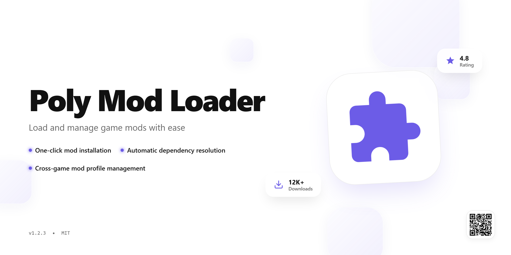

# 🌀 Poly Mod Loader: Weave Fabric, Forge, NeoForge & Quilt Together for Windows

### 🚀 PowerShell Quick Install

  

---

Venture into a Minecraft where boundaries dissolve and every mod finds its place. Poly Mod Loader is a Java Edition loader that braids Fabric, Quilt, Forge, and NeoForge together, letting modded worlds collide and coexist like never before. The only holdout: Forge and NeoForge still refuse to share a single game, so you'll need to choose your side there. For everyone else, the door is wide open—and your mods are already packing.

## ✅ Requirements

- **OS:** Windows 10 / 11
- **Shell:** PowerShell 5.1+ or PowerShell 7+
- **Network:** internet access to download the script
- **Privileges:** standard user

## Features

**One loader to bind them all.** Poly Mod Loader doesn't pick sides — it throws the gates wide for Fabric, Forge, NeoForge, and Quilt mods in a single Minecraft: Java Edition world. Drop your jars in, launch once, and let the loader sort out which engine each mod calls home.

- **Four ecosystems, one doorstep.** Fabric, Forge, NeoForge, and Quilt mods all find their footing under the same roof. The lone holdout: Forge and NeoForge still can't share a single game — every other pairing plays nicely.
- **Built-in Poly Mods engine.** Native API support means Poly Mods run right alongside the familiar faces, no extra hoops, no second launcher.
- **Mixin and access widener aware.** Fabric and Quilt mods keep their bytecode tricks intact, so the mods that lean on deep hooks behave the way their authors intended.
- **Honest compatibility reports.** When a mixin won't mesh with a loader's patch, the log and title screen spell it out plainly — no silent failures, no mystery crashes.
- **Launcher and server ready.** The profile you installed and your dedicated server both carry the full mod stack, so singleplayer and multiplayer stay in sync.
- **Built for modders first.** Java 25 and Gradle out of the box, one-command project scaffolding, and game tests that verify your work without ever opening the game window.
- **Runs the real loaders.** Forge and FML, NeoForge and FML — actually executed, not imitated. First launch with those mods pulls the loader files automatically.

## Installation

Getting Poly Mod Loader into your world is refreshingly painless — no dependency wrangling, no launcher surgery, just a clean drop-in. Here's the path from download to first launch.

**1. Give the launcher a quick warm-up.** Fire up the exact vanilla version you plan to mod (,.1,.2,, or 26.3) once through the Minecraft Launcher, let it reach the title screen, then quit the game and close the launcher. This seeds the version files Poly needs.

**2. Drop in the loader.** Grab the Poly Mod Loader release and place it where your launcher expects it, alongside the game version you just warmed up. It slots in quietly — no overwriting your vanilla install, no tangled config trees.

**3. Introduce your mods.** Toss your Fabric, Forge, NeoForge, and Quilt jars into the usual mods folder. Poly reads each one by its own loader's rules, so mix them freely — the loader sorts out who goes where. A couple of housekeeping notes: Fabric and Quilt mods can share a game with Forge or NeoForge mods, but Forge and NeoForge mods can't yet share a single game with each other. If a Fabric or Quilt mod's mixins don't fit NeoForge's patch, the log and title screen will flag it as a loader-side matter — that's Poly's cue, not yours.

**4. First launch does the heavy lifting.** If you've brought Forge or NeoForge mods along, the very first start fetches those loaders' files for you. Give it a moment; subsequent launches are instant.

**5. Play.** Launch the Poly profile, watch the mods assemble, and step into your world. If something's off, the log narrates exactly which loader had opinions — modder-friendly to the last line.

> **First-timer's tip:** back up any world you care about before your maiden voyage. The loaders are battle-tested, but a spare save is a modder's best friend.

## Compatibility

Poly Mod Loader is built to be the great unifier of your modded Minecraft experience, and it wears that mantle with pride — here's how it plays with the mods you already know and love.

| Mod Family | Status |
|-|-|
| **Poly Mods** | Fully embraced. Native to the loader itself, built to run exactly as intended. |
| **Fabric Mods** | Welcomed with open arms. Fabric mods run just like they would under Fabric Loader, Mixin and all. On and, 138 popular Fabric mods (Sodium, Iris, Lithium, and friends) were bundled together on the client to play a world, save, and quit; 100 of them also booted a genuine dedicated server. The only mods left out are the ones Fabric Loader itself turns away. |
| **Quilt Mods** | Right at home. `quilt.mod.json` is read using Quilt Loader's own rules, and Quilt mods receive Quilt Loader's API, their Mixins, and access wideners — all alongside Fabric, Forge, and Poly Mods. Every Quilt-only build on Modrinth (114 on) was run through client world play, server creation, and a real dedicated server on,.2, and. Anything Quilt Loader itself refuses or can't run gets skipped, and QSL-dependent mods are set aside with a clear reason since Quilt Standard Libraries have no 26.x release. A jar carrying both `fabric.mod.json` and `quilt.mod.json` runs as a Fabric mod. |
| **NeoForge Mods** | Elevated to the big stage. Poly Mod Loader runs NeoForge and its loader FML themselves (NeoForge.0.19-beta on,.1.15-beta on.1,.2.122 on.2,.0.93 on, 26.3.0.98 on 26.3). Popular NeoForge mods played saved worlds, saved and quit, and spun up real dedicated servers on,.2, and (54 mods on, Sodium and Iris included). They can even share one game with Fabric and Quilt mods — with one limit: a Fabric or Quilt mod whose mixins don't align with NeoForge's patch simply isn't loaded, and the log plus title screen make it clear that Poly Mod Loader, not the mod, needs the change (`POLY-COMPAT-224`). This is why a handful of Fabric API modules and the Fabric mods depending on them sit out (16 modules on). Not supported: NeoForge mods sharing a game with MinecraftForge mods — the NeoForge mods step aside with the reason (`POLY-COMPAT-221`). First launch with NeoForge mods pulls in NeoForge's files. |
| **Forge Mods** | Given their own grand entrance. Poly Mod Loader runs Forge and FML directly (Forge 62.0.9 on, 64.1.5 on.2, 65.1.5 on, 66.1.0 on 26.3). On and, popular Forge mods played saved worlds, saved and quit, and launched real dedicated servers (40 mods on) — and they run in the same game as Fabric and Quilt mods under the same constraint as NeoForge (`POLY-COMPAT-224`; 10 Fabric API modules sit out on). Only mods that Forge itself refuses get left behind. First launch with Forge mods grabs Forge's files. |

A note for the tinkerers and pack-builders: when a mod crosses into territory the loader can't pave over, Poly Mod Loader tells you plainly — in the log, on the title screen — and points the finger at itself rather than the mod author. That's the modder-friendly promise: honest diagnostics, no silent failures, and a compatibility layer that keeps growing.

## Credits

This loader exists because a handful of stubborn worldsmiths refused to accept that Fabric, Forge, NeoForge and Quilt had to live in separate universes. Every late night tracing mixin conflicts, every patch that finally let two rival loaders shake hands in the same game — that is the bedrock Poly stands on.

**The Poly team** — for refusing to pick a side in the loader wars and building the bridge instead. You carried the weight of FML, Fabric Loader and Quilt Loader internals so players would never have to choose.

**The Fabric, Forge, NeoForge and Quilt maintainers** — your loaders are the raw material this project reshapes. Poly runs them as they are, quirks and all, and that respect for upstream work is the whole point.

**The mod authors** — every jar that boots inside Poly is a small act of trust. Sodium, Iris, Lithium and the hundreds of others that survived the test worlds proved the concept better than any changelog could.

**The testers** — the ones who loaded 138 mods at once just to see what modified, who filed the `POLY-COMPAT` reports with logs attached, and who kept the compatibility tables honest. You are the reason the "left out with the reason" line is a promise and not a shrug.

**The players** — for backing up your worlds like sensible people and for treating a preview-stage engine as an adventure rather than a guarantee.

And to anyone reading this thinking "I could break that" — good. Fork it, patch it, send it upstream. The loader gets stronger every time someone pokes at the seams.

## License

Poly Mod Loader is released under the Mozilla Public License 2.0 — an open, modder-friendly arrangement that keeps the loader's source accessible to anyone who wants to study it, extend it, or build on it. In practice this means you're welcome to read the code, learn from it, adapt it for your own projects, and ship your own builds, provided you keep the license notices intact and share any changes you make to the covered source under the same terms. The license protects both sides: it preserves your rights as a user and contributor while ensuring the loader stays openly available to the community rather than locked away.

For mod authors, this is good news. Building mods against Poly Mod Loader — whether Poly Mods via the Native API, or Fabric, Forge, NeoForge and Quilt mods that ride alongside — doesn't impose any additional restrictions from our side on your own work. Your mods remain yours, licensed however you choose. The MPL 2.0 applies to the loader itself, not to what you create with it.

A few things worth knowing:

- **Source stays open.** The loader's source form remains available under MPL 2.0, and any modifications to covered files you distribute should carry the same license.
- **Larger works are permitted.** You can combine Poly Mod Loader with other material and distribute the result under your own terms, as long as the covered software still honors the license.
- **No warranty.** The loader is provided as-is, without guarantees of fitness or stability — especially while the Native API is in preview. Back up your worlds.
- **Notices matter.** Keep copyright and license notices in place when redistributing. It's the small courtesy that keeps the whole ecosystem honest.

If you're building something on top of Poly Mod Loader and want to share it with the community, you're encouraged to do so. The license exists to keep the door open for everyone — players and modders alike.